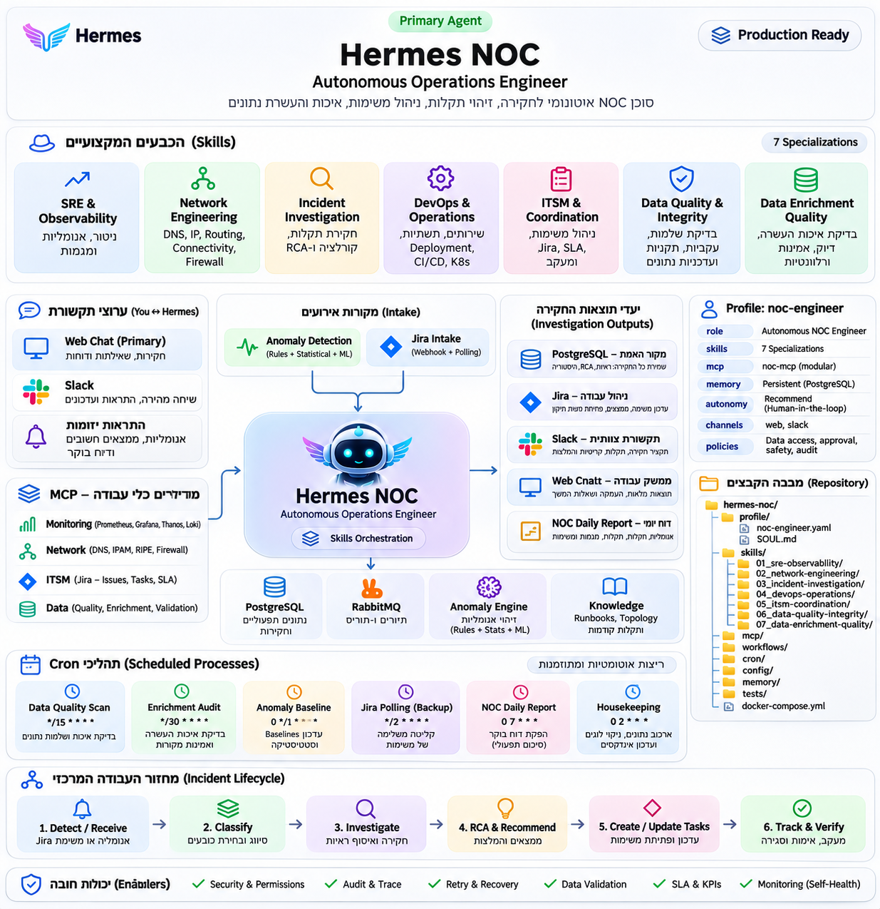

# Architecture

> **REQUIRES FROM NIR: E1 (docs/OPEN-QUESTIONS.md). Before implementing/filling run `python3 scripts/open_items.py --file docs/architecture.md`; if BLOCKED, ask Nir. Never invent.**

> LLM/DEVELOPER: write this from `project-map.he.md` once decisions are confirmed with Nir. Include: component diagram (Hermes, Skills, noc-mcp, anomaly-engine, event-ingestion, reporting), data flow for the 4 workflows (Grafana alert, proactive, Jira, daily report), what is deterministic Python vs LLM, and what is deliberately NOT built yet (multi-agent, ML, new dashboard, RabbitMQ/PostgreSQL).

Overview image:  (vision, not the MVP).
